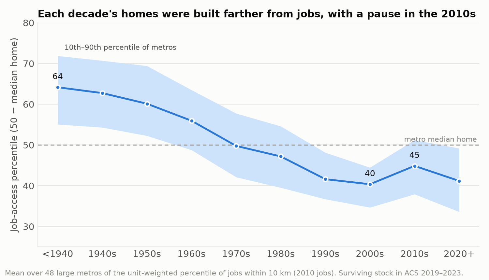
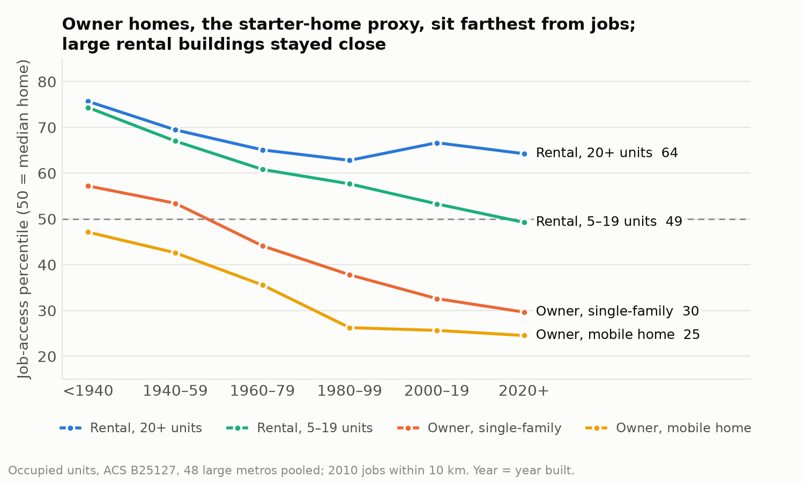
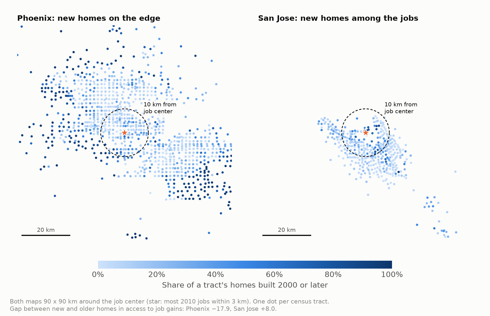
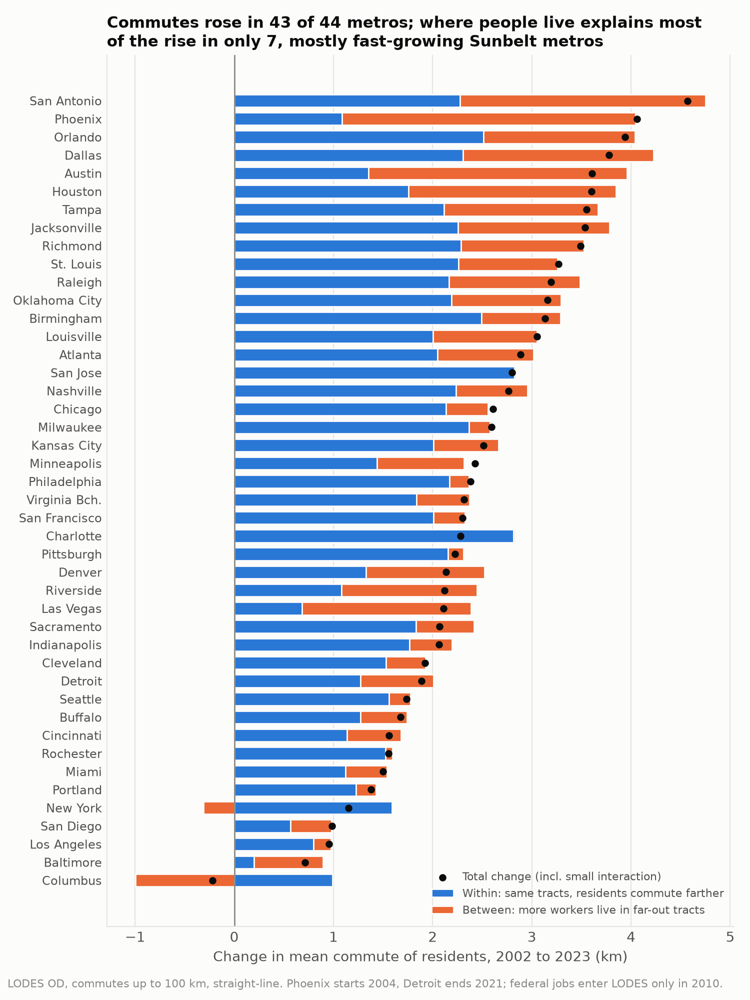

# Do new homes get built near jobs?

**Status: exploratory, descriptive (November 2026).** Where in US metro areas has housing been
built, decade by decade, relative to where the jobs are? And has that made commutes longer? The
package uses public Census data only and rebuilds everything with one command. Nothing here is a
causal estimate; the open causal design is described at the end.



## Findings

All numbers come from `empirics/results/`; the decisions behind them (D1–D16) are in
[`ANALYSIS_PLAN.md`](ANALYSIS_PLAN.md). Sample: the 50 largest metros by housing units, minus
Hartford and San Juan (48 metros, 43,370 census tracts).

1. **Each decade's homes were built farther from jobs.** Job access = share of the metro's jobs
   within 10 km of the tract, expressed as a percentile among all the metro's homes (50 = as close
   to jobs as the median home). Homes built before 1940 sit at the 64th percentile, 2000s homes at
   the 40th, with a partial rebound in the 2010s (45th) (figure 1, table 1).
2. **Owner single-family homes, a starter-home proxy, moved out most.** Built 2000–2019, they sit
   at the 33rd percentile; rental buildings with 20+ units of the same age at the 67th (figure 2).

   

3. **Actual commutes say the same.** Residents of tracts with pre-1940 homes have a median
   straight-line commute of 17.1 km (LODES 2023); for 2000s homes 22.3 km. Owner single-family homes
   built 2000–2019: 25.5 km; large rentals: 15.0 km (figure 5, table 4). The 10 km access measure
   predicts actual commutes better than distance to downtown does.
4. **New homes are farthest from new jobs in sprawling Sunbelt metros** (Phoenix, Las Vegas, San
   Antonio), and close to them in San Jose, New York and Seattle (figures 3, 4).

   

5. **Near jobs, housing supply is inelastic because the land is already built up.** Using
   Baum-Snow & Han's (2024) tract supply elasticities: 0.57 in the least job-accessible tenth of
   tracts, 0.12 in the most, tracking the share of land already developed (12% to 59%), not
   terrain. Across metros, the gap between new and older homes tracks how elastic the *edge* is,
   not the core (figures 6, 7).
6. **New jobs moved out too, but not as far as new homes.** In 38 growing metros, the inner 10 km
   held 35% of jobs in 2002 and received 18% of job growth to 2023; beyond 30 km lie 36% of homes
   built since 2010 but 27% of new jobs (figure 8).
7. **Commutes got longer: +2.4 km (18.5 to 21.0 km) between 2002 and 2023, in 43 of 44 metros.**
   About 70% of the rise is residents of the same tracts commuting farther; about 30% is workers
   living in far-out tracts. The second part dominates only in seven, mostly Sunbelt, metros
   (figure 9).

   

## Reproduce

```bash
uv sync                                     # Python 3.12 environment from uv.lock
uv run python run_all.py --with-collection  # download raw data, then clean -> process -> analyze -> tables, figures
uv run python run_all.py                    # rerun from data/raw/ once the raw files are present
```

Raw data are **not in the repository** (about 2 GB). `--with-collection` downloads them from the
original public sources; `data/raw/MANIFEST.sha256` holds the checksums of the files used here, and
each `data/raw/{dataset}/README.md` documents source, licence and retrieval date. Downloading takes
roughly 10 minutes (the LEHD server is slow; LODES files are fetched six at a time); the rest of the
pipeline about 5 minutes on a laptop. Each run writes `data/logs/run_all.log` and
`data/logs/session_info.log`, and appends a row to `attempts-log.csv`.

## Data

| Slug | Source | Used for |
|---|---|---|
| `acs` | Census ACS 2019–2023 5-year summary files, tables B25034, B25127 | homes by year built; by tenure × structure |
| `lodes` | LEHD LODES 8 workplace files (WAC), 2002 / 2010 / 2023 | jobs by tract |
| `lodes_od` | LEHD LODES 8 home-to-work files (OD), 2002 and 2023 | actual commutes |
| `gazetteer` | Census 2020 tract Gazetteer | tract internal points, land area |
| `cbsa` | OMB July 2023 metro delineation | tracts to metros |
| `bsh` | Baum-Snow & Han (JPE 2024) replication package, Harvard Dataverse (CC0) | tract supply elasticities |
| `tract_xwalk` | Census tract relationship files 2000–2010, 2010–2020 | elasticities onto 2020 tracts |

LODES gaps and fallbacks (Arizona 2004, Massachusetts 2011, DC 2010, Michigan 2021, ...) are
recorded in decision D3 and in `data/raw/lodes/README.md`.

## Layout

```
data/raw/{dataset}/        as downloaded (git-ignored except README.md and MANIFEST.sha256)
data/clean/, data/processed/   rebuilt by the pipeline (git-ignored)
data/scripts/              collection/ -> cleaning/ -> processing/, utils/
empirics/scripts/          01-07 analyses, 90 tables, 91 figures, analysis_config.py
empirics/results/          result CSVs, tables/, figures/, logs/
ANALYSIS_PLAN.md           decisions D1-D16, robustness list, change log
research-state.md          current state and session history
```

| Workfile | Unit | Built by |
|---|---|---|
| `tract_vintage` | 2020 tract (and tract × decade built, tract × structure cell) | `process_tract_vintage.py` |
| `tract_vintage/tract_commute.csv` | 2020 tract: 2023 commutes of residents | `process_tract_commute.py` |
| `tract_commute_trend` | 2020 tract × early/late year | `process_tract_commute_trend.py` |
| `tract_elasticity` | 2020 tract: Baum-Snow & Han elasticities | `process_tract_elasticity.py` |

## Limitations

- Year built is self-reported and covers only homes still standing in 2019–2023, so demolished
  older homes (mostly central) are missing.
- Distances are straight-line between tract internal points, not travel time.
- Commutes are measured for a tract's current residents and are shared by all homes in the tract.
- Federal jobs enter LODES only in 2010, and LODES residence imputation changed over time.
- Within a metro, Baum-Snow & Han's elasticity is a function of developed share, flatness and
  distance to the CBD, so linking it to where homes were built is partly mechanical.
- No regulation index yet (the Wharton index page was unavailable on 2026-11-23).

## Possible next steps

- Causal design: job-growth shocks predicted from each area's industry mix, interacted with the
  supply elasticity of the shocked area, to see where the induced housing lands.
- Minimum-commute split: how much of commuting is forced by where homes and jobs are, versus how
  workers match to jobs, in 2002 and 2023.
- Regional (CSA) version, to catch displacement across metro borders.
